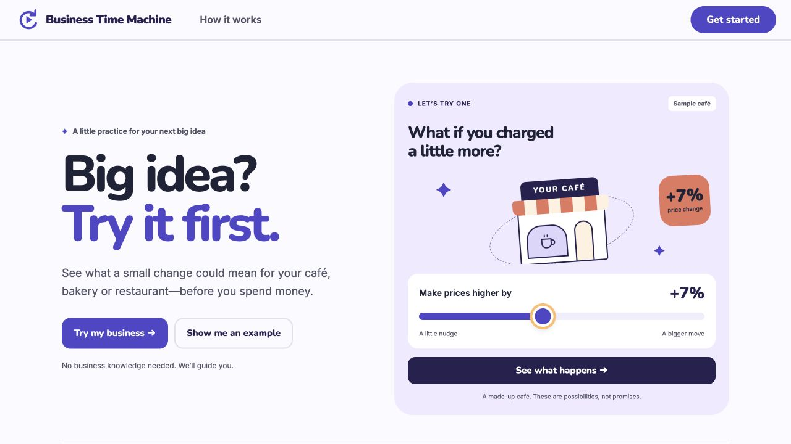
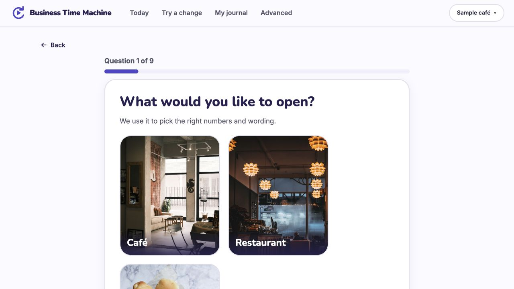
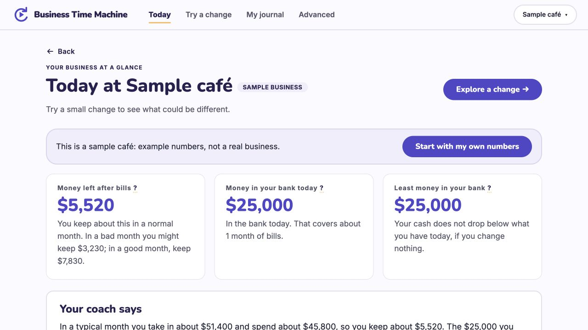
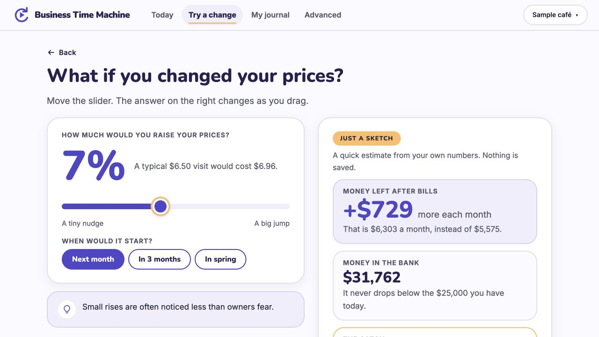
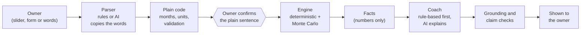

<div align="center">


# Business Time Machine

### Big idea? Try it first.

Try a small change to your café, bakery or restaurant and see what could happen—before you spend money. No business knowledge needed.

Created and maintained by **[Maryam Mafoud (@mafoudmaryam)](https://github.com/mafoudmaryam)**.



</div>

> **Status:** a personal project, still in development. The current design uses purple, lavender and coral, with the selected replay-loop logo and matching favicon.

**At a glance**

- **What:** try a business decision (raise prices, hire someone, run a promotion) and see good, likely and bad outcomes for the next 12 months.
- **How:** a deterministic simulation engine with Monte Carlo runs does all the maths; the AI only reads the owner's words and explains the engine's results.
- **Safeguards:** every number the AI writes is checked against the engine’s facts. AI-parsed decisions must be confirmed before simulation. Direct slider experiments show quick estimates without saving a plan.
- **Stack:** Python + NumPy engine, FastAPI + SQLAlchemy backend, React + TypeScript frontend.
- **Quality:** 1,800+ automated tests across engine, backend and frontend, plus automatic accessibility checks on every page.

---

## What it does

Most small food businesses make big choices on instinct: raise prices, hire a baker, run a promotion, change opening hours. Business Time Machine lets an owner try a choice first, in plain words, and see what could happen.

1. **Try a change on paper.** Move a slider or type "raise prices 10% in March". No plan is saved until you confirm it.
2. **See good, likely and bad cases for the next 12 months.** Profit, cash and customers, with a range instead of one magic number, compared with "if you change nothing".
3. **Get a coach that explains in plain words.** It says what happens, why, and what to watch out for. It starts with a short rule-based text and can add a fuller one from an AI.
4. **Keep a journal.** Write down what really happened each month and see how close the forecast was.
5. **No business yet? Start with a rough plan.** "I don't have a business yet" asks nine short questions and gives a rough start-up plan (see the next section).

## The start-up guide ("I don't have a business yet")



For someone who is only thinking about opening a café, restaurant or bakery. It asks nine questions, one per screen (what to open, country, budget, premises, size, menu, people, customers and spend, timeline) and then shows a **rough plan** on its own page: what it might cost to start (line by line, never one headline number), running costs a month, how many customers a day you need to break even, a starting budget with a cushion, a nine-item first-year checklist with "where to find it" pointers, and what you will probably struggle with. A button sets up a practice business from the answers so you can try changes in the simulator. Plans are saved on your computer only, can be edited, and can be deleted with Undo.

How it stays honest:
- **Every number has a source.** The numbers live in one data file (`engine/btm_engine/data/startup_ranges.json`), each with a source name, link and the date it was read; a test refuses a number without them. Our own rules (for example the contingency of 10% to 20%) are marked as **assumptions** with a reason, and shown on the plan page under "How we worked it out" next to every fact used. No AI writes anything on the plan page.
- **Wide on purpose.** Published guides disagree, so start-up cost is shown as labelled lines with their source and then a wide total range, explained in words. Vendor-written cost guides are shown as "published guides say" and named as coming from a company that sells to shops and restaurants.
- **Banner:** "This is a starting picture. It assumes your business is open and running smoothly." Everything says "A rough estimate, not advice."
- **Countries:** the **United States** has the full plan (sourced pay and cost figures). The **United Kingdom** and **China (mainland)** are "bring your own numbers": we show the official pay figures and the official licensing pointer, but you type your own rent and ingredient share, and there is no start-up cost total. **Anywhere else** gets the checklist only, with no cost numbers. A US restaurant has no start-up total either, because no source could be read.
- **Where we cannot help we say so**, with a link to the official page. No named suppliers and no affiliate links. We are not affiliated with the sites we link to.

The practice business starts at the plan's own break-even customers a day (with its cushion) when you hoped for more, so it begins as a careful picture rather than an unrealistically profitable one; the plan page and "What we assumed" say so. Limits: only some countries, start-up cost lines for a US café and a US bakery only, and a rough model that assumes you are already trading. A link checker (`engine/scripts/check_links.py`, run by hand, not part of the tests) last ran on 2026-10-10: 13 of 16 links worked and 3 (fda.gov, gov.cn, stats.gov.cn) could not be verified from the author's machine because of a certificate error there. They are kept, marked as not verified, and each page says "Links may change; last checked <date>."

## The golden rule

> **The AI never calculates a number.**
> A deterministic simulation engine, with Monte Carlo (many random "what if" runs) on top, does all the maths. The AI only does two jobs: it turns the owner's words into choices that the owner then confirms, and it explains facts that the engine produced. Every number in the AI's text is checked against those facts, and text that does not match is thrown away.

## A quick tour

1. **Start with an example.** Click **Show me an example** to explore a made-up café, or move the homepage slider and click **See what happens** for an inline price experiment.
2. **Understand the result.** The demo shows an order’s price before and after the change, money left after bills, and the possible loss of customer visits. **What else could happen?** reveals bank figures and how often the change comes out ahead in the simulated outcomes. These figures come from the simulation engine.
3. **Use your own business.** **Try my business** asks four short questions. If you have not opened yet, **I don’t have a business yet** opens the start-up guide.
4. **Explore one change at a time.** Today puts the financial figures first: **Money left after bills**, **Money in your bank today**, and **Least money in your bank**. The coach and charts explain the picture. Try a change, inspect the next 12 months, and confirm before saving a plan.
5. **Learn from what happens.** Record real months in My journal, check the assumptions under How we worked it out, or print a summary from Share. Detailed tools remain under Advanced.

The homepage uses a small animated café illustration and three short steps instead of long feature sections. The header stays simple, and extra figures are revealed when requested. Motion switches off when the device requests reduced motion.

### Today: your starting picture



*Example numbers for a made-up café. The key figures appear before the coach: money left after bills, money in the bank today, and its lowest modeled bank amount.*

### Try a change



*Move the price slider, compare the estimate and its possible downside, then explore the next 12 months. Nothing is saved as a plan until you confirm.*

These screenshots were captured from the current frontend on 2026-10-25 using a separate local preview database and sample figures. They show the purple/lavender design and selected replay-loop logo.


## Run it on your computer

These steps are for **Windows and PowerShell**.

**You need:**
- Python 3.10 or newer
- Node.js 20.19+ (or 22.12+)
- Git
- Optional: [Ollama](https://ollama.com), only if you want the local AI coach

**One-time setup:**

```powershell
git clone https://github.com/mafoudmaryam/business-time-machine.git
cd business-time-machine

# backend (its requirements also install the engine in editable mode)
cd backend
python -m venv .venv
.venv\Scripts\Activate.ps1
pip install -r requirements.txt
alembic upgrade head          # creates backend\btm.db
python seed_demo.py           # optional: adds a "Demo Cafe" with 3 scenarios

# frontend
cd ..\frontend
npm install
cd ..
```

**Start and stop.** Run these from the **project root folder** (the one that contains `start.ps1`):

```powershell
.\start.ps1      # opens the backend (port 8000) and the frontend (port 5173) in two windows
.\stop.ps1       # stops both
```

`start.ps1` stops anything that is already listening on port 8000 first. Then open <http://localhost:5173>.

**Try a sample.** Click **Show me an example** in the hero to open a sample café on Today. For a quick experiment on the homepage, move the price slider and click **See what happens**. The business-type cards also offer sample cafés, restaurants and bakeries. Samples use made-up numbers; choose **Try my business** to enter your own.

**Playing around without touching your real data.** `.\start.ps1 -TempDb` uses a brand-new throwaway database in your temp folder, so `backend\btm.db` is not used. Use it for any experiment.

### The coach: three modes

| Mode | What it is | How to switch it on |
|---|---|---|
| **Rule-based** (default) | Plain sentences written from the engine's facts. Free, instant, always available. It is also the fallback if the AI fails. | Nothing to do. |
| **Ollama** | A model running on your own computer. Free, but slow on a laptop without a graphics card (about 50 to 80 seconds on the author's laptop). | `COACH_PROVIDER=ollama` in `backend\.env` |
| **Anthropic (cloud)** | Claude through the official SDK. Needs an API key. | `COACH_PROVIDER=anthropic` and `ANTHROPIC_API_KEY=...` in `backend\.env` |

The coach never makes you wait: the rule-based text appears at once and the AI text replaces it later if it arrives and passes the checks. `COACH_ENABLED=false` switches the coach off completely.

**API keys go only in `backend\.env`.** Copy `backend\.env.example` to `backend\.env` and edit it. `backend\.env` is ignored by Git, so it is never committed. Never put a key in any file that is tracked by Git, and never paste one into an issue or a chat.

### Run the tests

```powershell
# from the project root; all three use the backend's virtual environment
cd engine;      ..\backend\.venv\Scripts\python.exe -m pytest   # 356 tests
cd ..\backend;  .\.venv\Scripts\python.exe -m pytest            # 679 tests
cd ..\frontend; npm test                                        # 792 tests
```

There is also an evaluation set of 48 hand-written sentences for the plain-language parser: `cd backend; .\.venv\Scripts\python.exe scripts\eval_interpret.py --provider template` (from the project root). Results are saved as CSV in `backend\eval_results\`.

## How it works



| Part | What it is |
|---|---|
| **Engine** (`engine/`) | A pure Python and NumPy package with no web or database code, so it can be tested and cited on its own. Monthly model of customers, visits, spend, costs, staff, marketing and cash, with Latin hypercube sampling and common random numbers (a fair, repeatable way to draw the random runs) so scenarios are compared fairly. See `engine/README.md`. |
| **Backend** (`backend/`) | FastAPI, SQLAlchemy and Alembic over SQLite (a small database stored in one file). `app/engine_bridge.py` is the only place that imports the engine. It also holds the coach, the plain-language parser and the journal. |
| **Frontend** (`frontend/`) | React, TypeScript, Vite and Recharts. A single typed API client (`src/api.ts`). |

**Three safeguards between the AI and the owner:**

1. **Grounding check.** Every number in AI text must exist in the engine's facts (6% rounding tolerance). If not, one retry, then the rule-based text is used.
2. **Claim consistency check.** The AI's risk statements ("your cash could run out") must agree with the engine's risk facts, in both directions. A mismatch means the rule-based text stays.
3. **Human in the loop.** Anything the AI read from the owner's words is shown as a plain sentence and must be confirmed. The backend refuses to simulate unconfirmed decisions. The one exception is the slider "sketch", which is the owner's own input, is labelled "just a sketch", is never saved and is never explained by the AI.

Every full run stores its engine version, random seed and number of iterations, so a result can be reproduced.

## Design

- **Purple, lavender and coral.** Shared tokens in `frontend/src/theme.css` define the palette, fonts and spacing. Legacy names such as `--green` now hold purple values for compatibility with existing styles. Chart colors in `src/chartTheme.ts` follow the same tokens; line patterns provide a second clue besides color.
- **Selected logo: replay loop.** A loop around a play symbol suggests trying a decision before committing. The navigation mark in `frontend/src/components/Logo.tsx` and `frontend/public/favicon.svg` share the same geometry. The favicon uses purple on light backgrounds and lavender for dark color schemes.
- **Made for beginners.** Short copy, a visual café experiment, everyday labels and optional detail replace the long feature/photo sections, repeated navigation and team quote. No financial figures are invented for the illustration or logo.
- **Readable and responsive.** Contrast tests retain WCAG AA checks; pages have automatic accessibility checks with `vitest-axe`. The logo and navigation were visually checked on desktop and at a 390-pixel phone width, and the favicon at 16 and 32 pixels on light and dark backgrounds.
- **Local fonts.** Nunito and Inter are served by the app. Patrick Hand remains available for existing accents. No external font service is required.
- **Gentle motion.** The café illustration moves subtly, and animations respect `prefers-reduced-motion`. Confetti appears only after a successful save, never to celebrate a forecast.
- **Plain printing and navigation.** Share prints black on white. A Back button on each page except Start returns to the previous page or its parent.

## Contributor

**[Maryam Mafoud (@mafoudmaryam)](https://github.com/mafoudmaryam)** — project creator and maintainer; business simulator, frontend design and logo direction.

## Quality

Latest frontend verification: **2026-10-25**, after the slider/result consistency fix.

| Check | Result |
|---|---|
| Frontend tests (Vitest, 56 files) | 792 passed |
| TypeScript check | clean |
| Production build (Vite) | succeeds; existing bundle-size warning remains |
| Lint (oxlint) | completes with existing warnings in unchanged files |
| Visual checks | earlier redesign: desktop and 390-pixel phone layout, 16/32-pixel favicons; slider fix: browser verification pending (browser download failed) |
| Logo consistency | navigation and favicon paths match the selected concept |

The engine and backend suites were **not rerun for these frontend and logo changes**. Their last documented full-project check, on 2026-10-10, recorded 356 engine tests passing and 678 of 679 backend tests passing. The backend failure was subsequently fixed and its file rerun (70 passing tests), but the full backend suite was not repeated. Historical results are kept separate from the latest frontend verification.

## Honest limits

- **It is a simplified model.** The answers are scenarios, not forecasts, and this is not financial advice.
- **Some settings are guesses.** The marketing and word-of-mouth settings are not calibrated against real data and look too optimistic; they are reused for all three industries. Restaurant and bakery defaults are typical-small-business estimates. The four-question start fills in the rest with rough rules (for example "other bills are a third of the rent"); the app shows every guess and lets you change it.
- **The example numbers are US-based.** Currency and number formatting adapt, but the typical amounts are US dollars. There are no seasons in the model yet.
- **The coach can be wrong.** The checks catch numbers that are not in the facts and risk claims that contradict them, but they read phrases, not meaning. The instant rule-based text is the reliable one.
- **The cloud AI provider is not covered by automated tests with a real key.** The tests replace every provider with a stand-in, so the Anthropic mode has not been verified against the live service by this test suite.
- **The plain-language parser's score is optimistic.** The rule-based one gets 44 of 48 test sentences exactly right, but it was written alongside those sentences. A fresh, independent test set is still needed.
- **The journal is a pilot.** A few months of figures cannot prove a forecast right or wrong.
- **Pictures.** The current homepage café is a CSS/SVG illustration. Business-type photos are stock images, not real customers. Earlier AI-generated images remain in the repository and historical screenshots; see [Images](#images).

## Why I built this

This is a personal project. Small food-business owners make big choices (prices, hiring, opening hours) on instinct, and spreadsheets are slow to build and easy to get wrong. I wanted a simulator that lets an owner try a decision on paper first, see a good, likely and bad case, and have it explained in plain words, without ever letting an AI make up a number.

**A possible small test.** One day I may ask a few real owners to try the app, some with the coach and some without, and then tell me how confident they felt (a 1 to 7 score) and how easy it was to use (the System Usability Scale, a standard 10-question form). That would only happen with their consent and with as little personal data as possible. The idea is written down in `docs/study-mode-plan.md`. **None of it is built, and no test has been run: no owners have been asked and no data has been collected.**

What does exist for this: the coach can be switched off (`COACH_ENABLED=false`), and every AI call, retry and fallback, plus how each parsed step was confirmed or edited, is logged in the local database.

## Roadmap

**Done**
- [x] Simulation engine for café, restaurant and bakery
- [x] Coach with grounding and claim checks, rule-based first and non-blocking
- [x] Plain-language decision input ("describe it in your own words")
- [x] Simple four-question start, sample businesses, Today page
- [x] Business switcher, delete with undo, "← Back" on every page
- [x] Try a change and the 12-month view
- [x] How we worked it out, a print or PDF summary, friendly empty and error states
- [x] My journal (pilot)
- [x] Beginner-friendly purple/lavender design with a visual homepage price experiment
- [x] Replay-loop logo and matching light/dark favicon
- [x] Plain-language result labels and optional detail
- [x] Start-up guide for people with no business yet (US full; UK and China bring your own numbers; elsewhere checklist only)

**Next**
- [ ] Study mode and a possible small test with real owners (only a possible idea for now; the open questions are in `docs/study-mode-plan.md`, and it needs the owners' consent)
- [ ] A fresh, held-out test set for the plain-language parser
- [ ] More countries for the start-up guide, once a source can be read for each
- [ ] A more realistic model (calibrating marketing and word of mouth, seasons)
- [ ] Online deployment, user accounts and PostgreSQL (sketched in `CLAUDE.md`, not started)
- [ ] Streaming explanations

See [CHANGELOG.md](CHANGELOG.md) for what changed and when.

## Privacy and data

- **Stored on your computer.** In the default setup everything lives in a local SQLite file, `backend/btm.db`. Nothing is sent anywhere, and the app loads no outside fonts or scripts. If you switch on the **cloud AI coach**, the engine's facts and any text you type into the "say it in your own words" or "Ask the coach" boxes are sent to that provider; the local Ollama mode keeps everything on your machine.
- **Keep experiments separate.** Use `.\start.ps1 -TempDb` for a throwaway preview database. Samples created by clicking the app are stored in whichever database the backend is using; the inline price estimate does not save a plan. Automated tests use their own temporary databases. Databases and backups are ignored by Git.
- **Delete is reversible.** Deleting a scenario, a result, a journal month or a business only hides it, and an Undo message stays for 8 seconds. Nothing is erased for good by itself. To erase old deleted items on purpose: `cd backend; .\.venv\Scripts\python.exe scripts\purge_deleted.py` shows what would go; add `--older-than-days 30 --yes` to really delete. The AI logs are kept even then, as logged data.
- **The journal's CSV download** is made in your browser from what is on screen.
- **No accounts and no tracking of who you are.** The app records anonymous usage events (which screen, which button) in your own database, with no free text.

## Project layout

```
engine/      Simulation engine (pure Python and NumPy)
backend/     FastAPI app, database, coach, plain-language parser, tests, scripts
frontend/    React and TypeScript app
docs/        Plans (beginner journey, study mode), screenshots
start.ps1    Starts both dev servers (from the project root)
stop.ps1     Stops both dev servers
CLAUDE.md    Project rules and the current state, for the AI coding assistant
CHANGELOG.md What changed, phase by phase
```

## Credits

- **Fonts:** Nunito, Inter and Patrick Hand, under the SIL Open Font License (see `frontend/public/fonts/README.md`).
- **Industry photos** (café, restaurant, bakery): stock photos from Pexels, with photographers listed in `frontend/public/images/CREDITS.md`.
- **Homepage illustration and logo:** CSS/SVG artwork. Earlier AI-generated image assets remain credited under [Images](#images).

## Images

The current homepage café is built in CSS/SVG, and the replay-loop logo and favicon are vector artwork. They do not depict real customers or owners.

The café, restaurant and bakery photos used for business types and other pages are stock photos from Pexels; photographers are credited in [`frontend/public/images/CREDITS.md`](frontend/public/images/CREDITS.md).

The older hero, desk, tablet and notes images are AI-generated illustrations made with ChatGPT (OpenAI) from text prompts in October 2026. They remain in the repository and earlier screenshots but are no longer the homepage feature cards. Their original credits are retained in [`frontend/public/images/redesign/CREDITS.md`](frontend/public/images/redesign/CREDITS.md).

## Licence

**Not yet chosen.** There is no `LICENSE` file, so all rights are reserved by the author until one is added.


